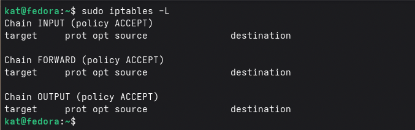
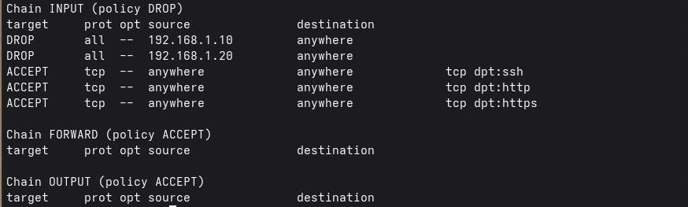
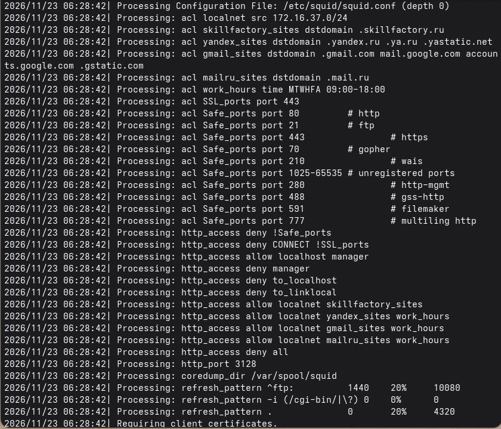
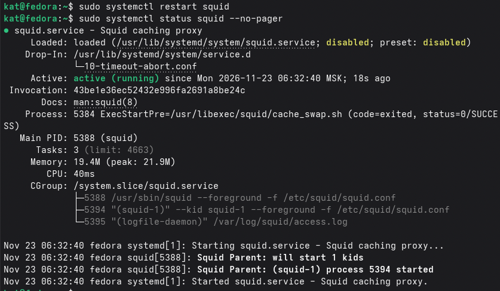
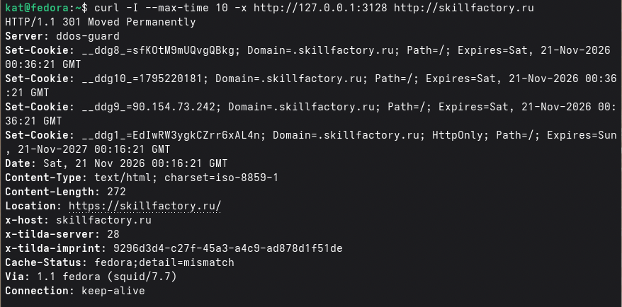
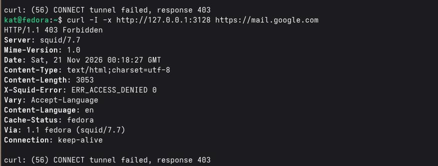
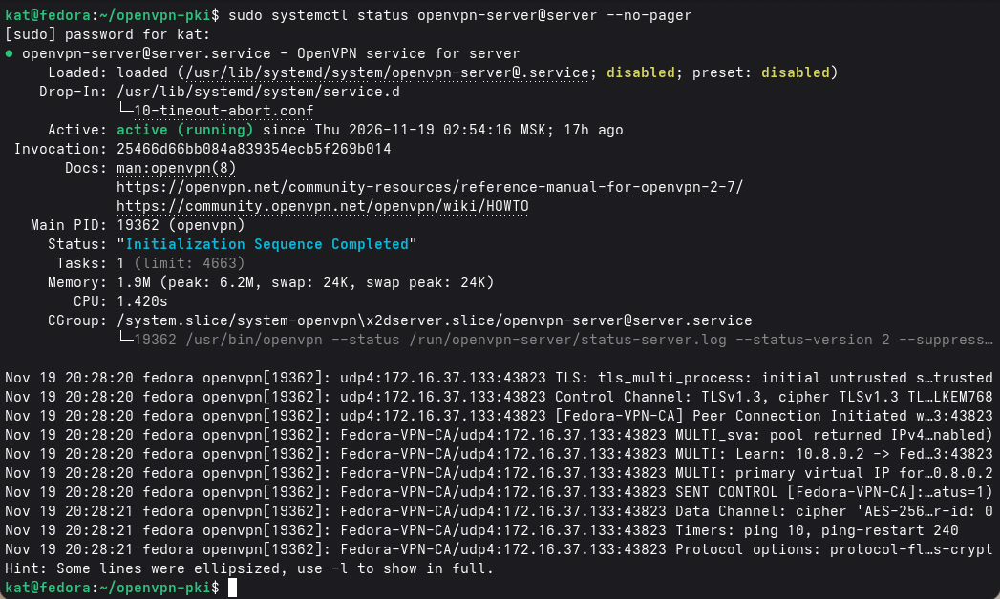
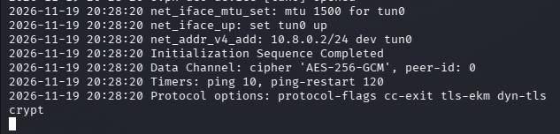
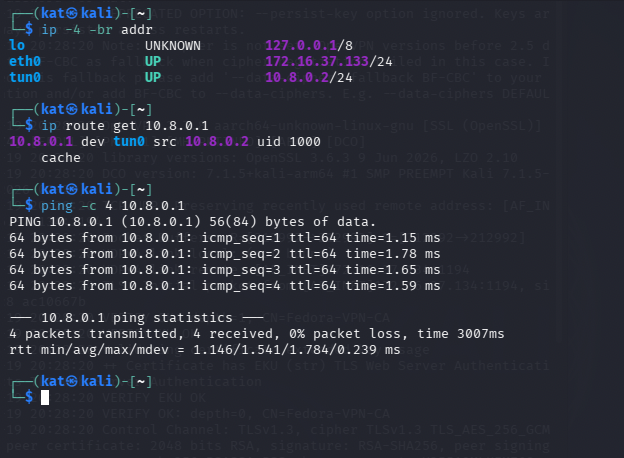

# Технические средства защиты информации — Лабораторные работы  
  
## Навигация  
  
| Лабораторная работа | Краткое описание | Файлы и скриншоты |
|---|---|---|
| [**Лабораторная работа iptables**](#лабораторная-работа-iptables) | Настройка правил фильтрации входящего трафика и ограничение доступа по IP-адресам | [Вывод iptables -L](screenshots/iptables.png) |
| [**Лабораторная работа Squid**](#лабораторная-работа-squid) | Управление доступом к веб-сайтам с ограничением по времени | [Проверка конфигурации squid parse](screenshots/squidparse.png), [Статус службы](screenshots/squid_check.png), [Skillfactory](screenshots/skillfactory.png), [Яндекс](screenshots/yandex.png), [Gmail](screenshots/gmail.png), [Mail.ru](screenshots/mail.png) |
| [**Лабораторная работа OpenVPN**](#лабораторная-работа-openvpn) | Настройка защищённого VPN-соединения между клиентом и сервером | [Статус сервера](screenshots/openvpn-server-status.png), [Подключение клиента](screenshots/openvpn-client-connected.png), [Проверка VPN-туннеля](screenshots/openvpn-client-route-ping.png) |
  
---
  
## Лабораторная работа iptables  
  
### Задание   
Настройте правила `iptables` для создания базового файрвола на сервере.  Разрешите доступ только к службам *SSH* (порт 22), *HTTP* (порт 80) и *HTTPS* (порт 443).  Ограничьте доступ с определенных IP-адресов к вашему серверу, и запретите весь остальной входящий трафик.  В качестве решения предоставьте список команд для настройки и продемонстрируйте вывод команды `iptables -L`.  
  
### Список команд  
  
*Дополнительно проверены текущие правила - перед основным блоком команд:*
```
sudo iptables -L
```  
  
   
  
Ограничение доступа с определенных адресов,  правило доступа к службам *SSH* (порт 22), *HTTP* (порт 80) и *HTTPS* (порт 443), запрет на входящий трафик:  
```
sudo iptables -A INPUT -m conntrack --ctstate ESTABLISHED,RELATED -j ACCEPT
sudo iptables -A INPUT -p tcp -s 192.168.1.10,192.168.1.20 -m conntrack --ctstate NEW -m tcp --dport 22 -j ACCEPT
sudo iptables -A INPUT -p tcp -s 192.168.1.10,192.168.1.20 -m conntrack --ctstate NEW -m multiport --dports 80,443 -j ACCEPT
sudo iptables -P INPUT DROP
sudo iptables -L
```  
  

### Вывод команды `iptables -L`  
   
  
  
---
  
## Лабораторная работа Squid  
  
### Задание  
  
Настройте прокси-сервер Squid для контроля доступа к веб-сайтам.   
Реализуйте следующие требования:  
  
1. Запретите все, что не разрешено.  
2. Разрешите доступ до сайта skillfactory.ru.  
3. Разрешите доступ к поисковику (Яндекс).  
4. Разрешите доступ к почтовым сервисам (Gmail и mail.ru).  
5. П.3 и 4 настроить в рабочее время (с 9.00 до 18.00) с понедельника по субботу включительно.  
  
В качестве решения предоставьте список изменений, внесенных в файл `/etc/squid/squid.conf`.  
  
### Список команд  
  
Прокси сервер  
```
sudo dnf install squid -y
```  
  
В 1 лаб. политика INPUT DROP, поэтому разр. loopback:
```
sudo iptables -I INPUT 2 -i lo -j ACCEPT
```
  
Список изменений файла `/etc/squid/squid.conf`:  
```
# Локальная сеть
acl localnet src 172.16.37.0/24

# Разрешённые ресурсы
acl skillfactory_sites dstdomain .skillfactory.ru
acl yandex_sites dstdomain .yandex.ru .ya.ru .yastatic.net
acl gmail_sites dstdomain .gmail.com mail.google.com accounts.google.com .gstatic.com
acl mailru_sites dstdomain .mail.ru
acl work_hours time MTWHFA 09:00-18:00
…
…
# http_access allow localhost
…
…
# Skillfactory — без ограничения по времени
http_access allow localnet skillfactory_sites

# Яндекс — только в рабочее время
http_access allow localnet yandex_sites work_hours

# Gmail — только в рабочее время
http_access allow localnet gmail_sites work_hours

# Mail.ru — только в рабочее время
http_access allow localnet mailru_sites work_hours
…
…

http_access deny all

```

Проверка конфигурации Squid:  
```
sudo squid -k parse
```  
  
   
  
Перезапуск Squid, проверка службы  
```
sudo systemctl restart squid
sudo systemctl status squid --no-pager
```  
  
Результат `active (running)`:  
  
  
  
### Проверка  
  
***Skillfactory***  
```
curl -I --max-time 10 -x http://172.16.37.134:3128 http://skillfactory.ru
```  
  
Результат: `HTTP/1.1 301 Moved Permanently`.  
  
  
  
***Яндекс***  
```
curl -I -x http://172.16.37.134:3128 https://yandex.ru
```  
  
Результат - `403`:  
  
  
   
***Gmail***  
```
curl -I -x http://172.16.37.134:3128 https://mail.google.com
```  
  
 Результат - `403`:  
  
  
  
***Mail.ru***  
```
curl -I -x http://172.16.37.134:3128 https://mail.ru
```  
  
Результат - `403`:  
  
  
    
P.S. проверка проводилась вне разрешенного времени - поэтому 403 ожидаемо у Яндекс, Gmail, Mail.ru.  
  
## Лабораторная работа OpenVPN  
  
###  Задание  
  
Настройте VPN-сервер с использованием OpenVPN для обеспечения защищенного соединения между клиентом и сервером.  
  
Выполните следующие шаги:  
  
1. Установите и сконфигурируйте OpenVPN по умолчанию на сервере.  
2. Сгенерируйте сертификаты для сервера и клиента.  
3. Настройте файлы конфигурации сервера и клиента.  
4. Подключите клиент к серверу, используя созданные сертификаты и конфигурацию.  
5. Проверьте, что соединение работает, передавая трафик между клиентом и сервером через защищенное VPN-подключение.  
  
В качестве решения предоставьте список команд для настройки и работу VPN-подключения.  
  
*Задание выполнено на двух виртуальных машинах — Fedora Linux (сервер) и Kali Linux (клиент).*  
  
### Список команд  
  
Установлены OpenVPN и Easy-RSA:  
```
sudo dnf install openvpn easy-rsa
```  
  
Директория Easy-RSA:  
```
umask 077
mkdir -p $HOME/openvpn-pki
cp -a /usr/share/easy-rsa/3/. $HOME/openvpn-pki/
cd $HOME/openvpn-pki
```  
  
Созданы PKI и CA:  
```
./easyrsa init-pki
./easyrsa build-ca
```  
  
Common Name CA: `Fedora-VPN-CA`.  
  
Сгенерирован и подписан сертификат сервера:  
```
./easyrsa gen-req server nopass
./easyrsa sign-req server server
```  
  
Сгенерирован и подписан сертификат клиента (см. P.S. в конце):  
```
./easyrsa gen-req mac-client nopass
./easyrsa sign-req client mac-client
```  
  
Дополнительный ключ TLS-Crypt:  
```
openvpn --genkey tls-crypt tls-crypt.key
```  
  
Создан сис.каталог, скопированы сертификаты, ключи.  
```
sudo install -d -m 700 /etc/openvpn/server

sudo install -m 644 pki/ca.crt /etc/openvpn/server/ca.crt
sudo install -m 644 pki/issued/server.crt /etc/openvpn/server/server.crt
sudo install -m 600 pki/private/server.key /etc/openvpn/server/server.key
sudo install -m 600 tls-crypt.key /etc/openvpn/server/tls-crypt.key

sudo restorecon -Rv /etc/openvpn/server
```  
  
Конфигурационный файл сервера `server.conf`:  
```
sudo nano /etc/openvpn/server/server.conf
```  
  
 `/etc/openvpn/server/server.conf`:  
```
# Сетевые параметры
port 1194
proto udp4
dev tun

# Виртуальная сеть VPN
topology subnet
server 10.8.0.0 255.255.255.0

# Сертификаты и ключи
ca /etc/openvpn/server/ca.crt
cert /etc/openvpn/server/server.crt
key /etc/openvpn/server/server.key

# Обмен ключами
dh none

# Дополнительная TLS-защита
tls-crypt /etc/openvpn/server/tls-crypt.key

# Проверка сертификатов клиента
verify-client-cert require

# Шифрование
data-ciphers AES-256-GCM:AES-128-GCM

# Проверка активности соединения
keepalive 10 120

# Сохранение ключа и интерфейса
persist-key
persist-tun

# Уровень подробности журнала
verb 3
```  
  
Файл `mac-client.ovpn`:  
```
cd $HOME/openvpn-pki
umask 077

cat > mac-client.ovpn <<'EOF'
client
dev tun
proto udp
remote 172.16.37.134 1194
resolv-retry infinite
nobind
persist-key
persist-tun
remote-cert-tls server
verb 3
<ca>
EOF
```  
  
Сертификаты и ключи в конфигурации клиента `mac-client.ovpn`:   
```
cat pki/ca.crt >> mac-client.ovpn
printf '\n</ca>\n<cert>\n' >> mac-client.ovpn

cat pki/issued/mac-client.crt >> mac-client.ovpn
printf '\n</cert>\n<key>\n' >> mac-client.ovpn

cat pki/private/mac-client.key >> mac-client.ovpn
printf '\n</key>\n<tls-crypt>\n' >> mac-client.ovpn

cat tls-crypt.key >> mac-client.ovpn
printf '\n</tls-crypt>\n' >> mac-client.ovpn
```  

Права доступа к `mac-client.ovpn`:  
```
chmod 600 mac-client.ovpn
```   
  
OpenVPN-подключения по UDP-порту 1194 из сети ВМ:  
```
sudo iptables -A INPUT -s 172.16.37.0/24 -p udp --dport 1194 -j ACCEPT
```  
  
ICMP-трафик через VPN-инт.:  
```
sudo iptables -A INPUT -i tun0 -s 10.8.0.0/24 -p icmp -j ACCEPT
```  
  
Проверка правил:  
```
sudo iptables -L INPUT -n -v
```  
  
Запуск OpenVPN-сервера (Fedora)  
```
sudo systemctl start openvpn-server@server
```  
  
Проверка службы:  
```
sudo systemctl status openvpn-server@server --no-pager
```  
  
Результат: `active (running)` — VPN-сервер запущен:  
  
  
  
Клиентская конфигурация передана с Fedora на Kali через *SCP*:  
```
scp -o ConnectTimeout=5 kat@172.16.37.134:openvpn-pki/mac-client.ovpn ~/kali-client.ovpn
```  
  
Права доступа к `kali-client.ovpn`:  
```
chmod 600 ~/kali-client.ovpn
```  
  
VPN-клиент запущен:  
```
sudo openvpn --config $HOME/kali-client.ovpn
```  
  
`Initialization Sequence Completed` — VPN-соединение установлено:   
   
  
  
Алгоритм шифрования: `AES-256-GCM`. 
  
Сетевые интерфейсы на Кали, маршрут через VPN-server, передача пакетов через Vpn-tun:
```
ip -4 -br addr
ip route get 10.8.0.1
ping -c 4 10.8.0.1 
```
  
Проверен маршрут до VPN-server, создан сетевой интерфейс `tun0` - через него успешно проходит VPN-трафик:   
  
  
  
**P.S. Имя `mac-client` изначально создавалось, потому как macOS планировалась использоваться как клиент.По итогу оставила это имя, а клиент в итоге стал Kali.**  
